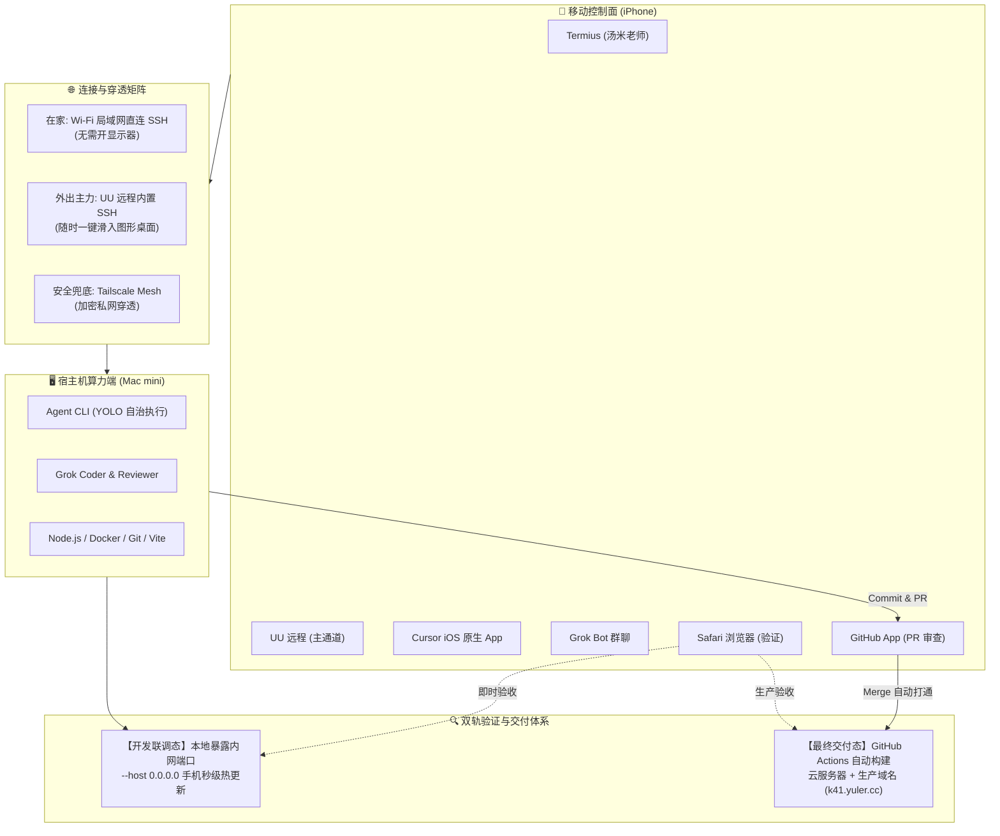
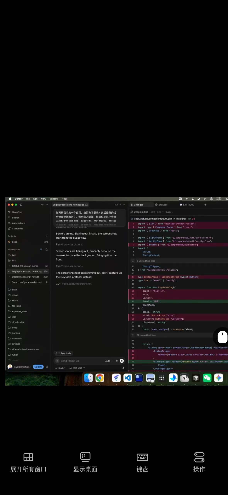
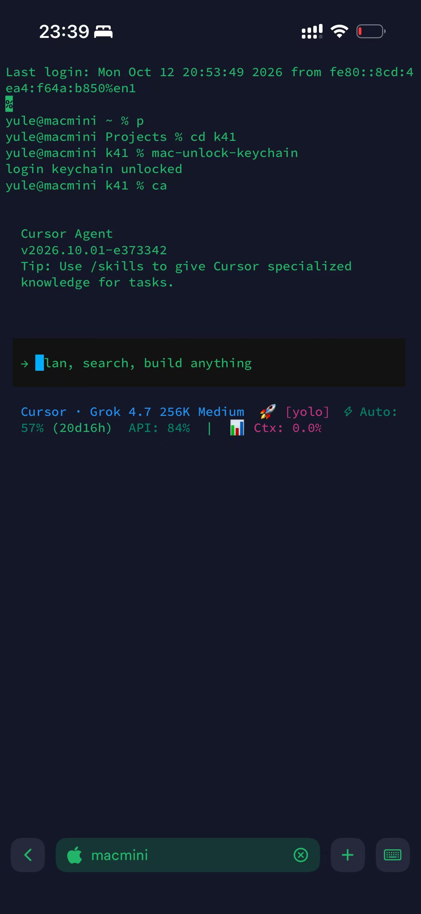
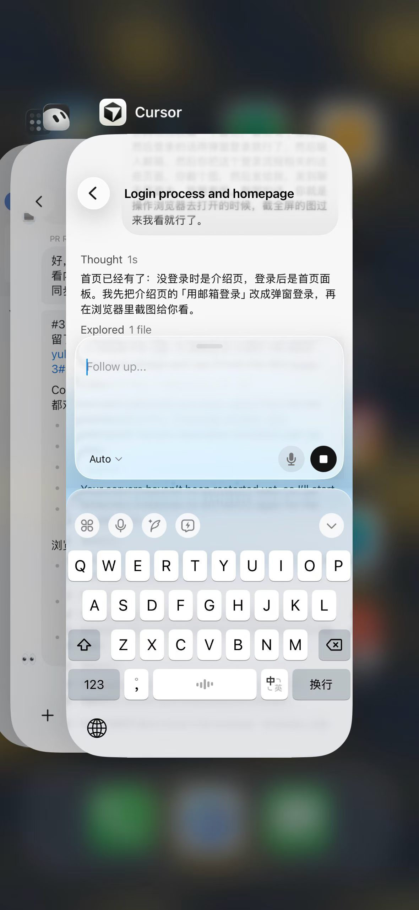
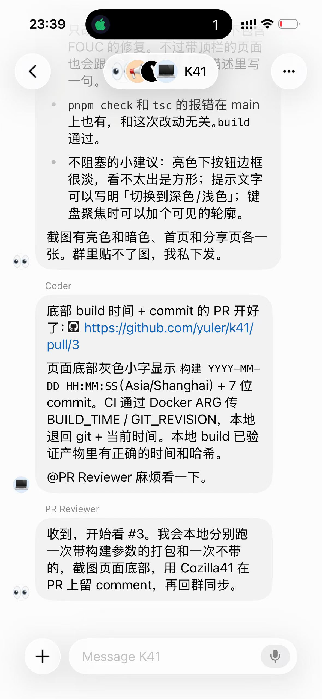
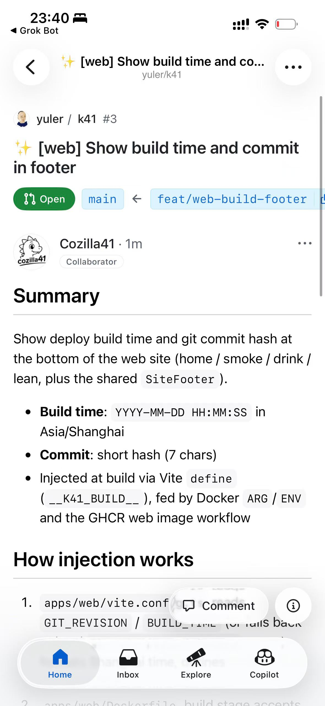
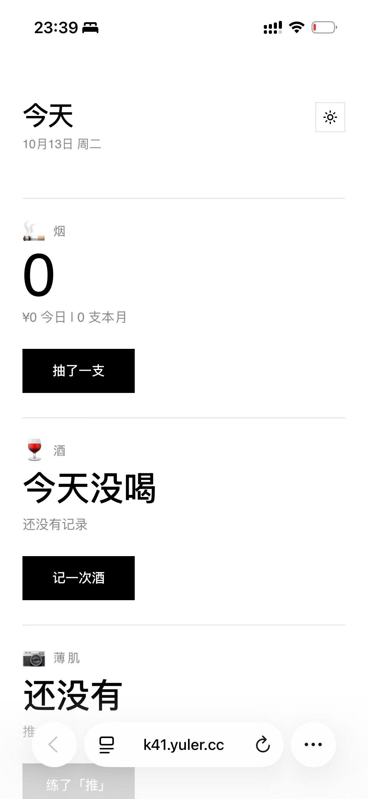

# 纯手机 Vibe Coding 实战

### 用一部 iPhone 掌控 Mac mini 与多 Agent 生产闭环

  📱 iOS / Termius 控制面
  🖥️ Mac mini 私有算力端
  🤖 多 Agent 协同生态
  🚀 双轨验证与秒级上线

  分享人：Yuler · 开发者极客社区技术分享

<!--
各位同行、朋友们大家好！今天我想和大家分享一个彻底改变我日常开发习惯的实践：
“完全通过手机进行 Vibe Coding 实战”。

以前一提到“用手机写代码”，大家的第一反应往往是：屏幕那么小、没有机械键盘、没有终端、写代码纯属自虐。
但大模型时代彻底重构了这一切——
我们不再需要用手指去逐行敲击语法符号，编程的核心变成了“意图表达”与“架构决策”。
今天这套方案，将系统拆解我是如何在通勤路上、甚至躺在沙发上，仅凭一部 iPhone，调度家里常开的 Mac mini，
通过 UU 远程、Termius（汤米老师）、Cursor 移动端与 Grok 机器人，
完成从需求派单、终端交互、代码审查到内网秒级调试与线上自动化发布的全套生产闭环！
-->

---
layout: default
---

# 核心思想：AI 时代为什么可以用手机编程？

告别语法打字，手机是意图控制台，算力与环境后置到主机

  <h3 class="text-red-400 font-bold text-lg mb-3 flex items-center gap-2">
    ❌ 传统移动端编程痛点
  </h3>
  <ul class="space-y-3 text-sm text-slate-300">
    <li><b>输入低效：</b> 手机软键盘缺少代码符号（括号、分号、缩进），手工输入效率暴跌 80%</li>
    <li><b>环境缺失：</b> 移动端 OS 无法本地运行 Node、Docker、编译器等重型开发套件</li>
    <li><b>调试艰难：</b> 屏幕局限，无法同时容纳代码编辑器、终端和浏览器多窗口</li>
    <li><b>工具繁冗：</b> 依赖各种沉重的 IDE 插件与复杂的语法提示/补全配置</li>
  </ul>

  <h3 class="text-emerald-400 font-bold text-lg mb-3 flex items-center gap-2">
    ✨ AI Native 时代的 Vibe Coding
  </h3>
  <ul class="space-y-3 text-sm text-slate-300">
    <li><b>编码全包：</b> 代码编写由 AI 全权接管，不再需要任何软键盘符号与语法提示</li>
    <li><b>SSH 极简通道：</b> 核心本质就是通过极简的 SSH 终端，直连自己常开的电脑或服务器</li>
    <li><b>算力私有：</b> 家里一台静音低功耗 Mac mini 常年开机，免额外云服务器费用且复用本地凭据</li>
    <li><b>职责升维：</b> 手机只负责发号施令、把关架构与验收成果，成为掌上总指挥台</li>
  </ul>

  💡 核心哲学：计算留在家里，AI 顶在前面，控制握在掌心。

<!--
我们先来聊透“核心思想”。
为什么以前用手机写代码是受罪，现在却变成了一种享受？
因为编程的本质变了。过去写代码 80% 的精力花在键盘敲语法、查文档补全、配环境上。
但在今天：
第一，代码逻辑由 AI 全权负责编写，我们根本不需要在手机屏幕上逐个输入大括号、箭头函数或分号，甚至连语法高亮和补全提示都不再是必需品。
第二，连接的本质极其纯粹——就是一条通往后端的 SSH 终端连接。
手机只做控制面（Control Plane），家里的 Mac mini 做算力面（Compute Plane）。M 芯片 Mac mini 功耗只有几瓦，常年静音开机，零服务器账单，而且本地 Keychain、Git 凭据应有尽有。
你只需要负责清晰表达意图，敲回车让 Agent 跑起来。
-->

---
layout: default
---

# 整体系统拓扑：端到端解耦架构

内网直连 + 外网主力穿透 + 双轨验证闭环

<!--
大家看这张最新的全景系统拓扑：
整套架构分为四个模块：
1. 移动控制面：手机上的 Termius、UU 远程、Cursor iOS、Grok 机器人群、GitHub App 与 Safari 浏览器；
2. 连接与穿透矩阵：
   - 在家时：直接通过家庭 Wi-Fi 局域网连 SSH，电脑屏幕都不需要点亮；
   - 出门在外：以 UU 远程为主力，常规使用内置 SSH，遇到特殊图形需求一键切入桌面；Tailscale 作为虚拟私网兜底；
3. 宿主机算力端：Mac mini 常年挂载，跑着 CLI Agent、多机器人后台与前端工具链；
4. 双轨验证体系：
   - 快速改样式走本地内网暴露端口，秒级热更；
   - 正式发布走 GitHub Actions 自动打通，上线生产域名。
-->

---
layout: default
---

# 隧道连接工具矩阵：内外网打通方案

宿主机预先授权 Agent，手机随时随地秒进开发会话

  

    

      <h3 class="text-sky-400 font-bold text-base">🖥️ 电脑/节点端：穿透与远程矩阵</h3>
      宿主机已授权 Agent
    

    <ul class="space-y-3 text-xs text-slate-300 mt-2">
      <li>
        <b class="text-sky-300">🏠 在家直连场景：</b> 
        无需开电脑屏幕，直接基于家庭局域网 IP 直连 SSH，延迟趋近于 0，极速进入工作状态。
      </li>
      <li>
        <b class="text-emerald-300">🌟 外出主力 · UU 远程 (UU Remote)：</b> 
        • <b>常规主力：</b>使用 UU 远程内置的 SSH 终端，穿透稳定迅速。 
        • <b>备用逃生舱：</b>自带低延迟图形桌面，需要启动特定 GUI 应用或看 DevTools 时一键切入。
      </li>
      <li>
        <b class="text-purple-300">🛡️ 安全兜底 · Tailscale：</b> 
        基于 WireGuard 的加密 Mesh 虚拟私网，在复杂网络环境下提供零端口暴露的安全直连兜底。
      </li>
    </ul>
  

  

    💡 提示：Mac mini 无头运行，通过快捷脚本自动解锁 Keychain。
  

  

    

      <h3 class="text-emerald-400 font-bold text-base">📱 手机端：终端连接利器</h3>
      iOS 首选推荐
    

    <ul class="space-y-3 text-xs text-slate-300 mt-2">
      <li>
        <b class="text-emerald-300">⚡ Termius（汤米老师）：</b> 
        iOS 生态综合体验最好的 SSH 客户端。支持多主机分组、会话保持与弱网自动重连。
      </li>
      <li>
        <b class="text-amber-300">🚀 Snippets 快捷宏指令：</b> 
        把常用长指令（如调起 Agent CLI、进入工程目录、启动 dev 服务）预置为快捷块，单指一触即发。
      </li>
      <li>
        <b class="text-sky-300">⌨️ 触控优化手势键盘：</b> 
        配备专为 Terminal 设计的辅助功能键（Esc、Tab、Ctrl、方向键），操作 Shell 行云流水。
      </li>
    </ul>
  

  

    💡 场景：在家用局域网直连 Termius；在外直接走 UU 远程内置终端或 Tailscale。
  

  🔑 核心认知：连接工具的目标是<b>“消除物理距离”</b>，让常开的主机如同放在口袋里一样触手可得。

<!--
在第二部分，我们来重点拆解隧道连接工具。
这是很多尝试“手机写代码”的同学卡住的第一道门槛：
很多人以为连远程必须买昂贵的公网 IP 服务器，其实完全不需要。
我们分两个场景：
第一个场景是在家：你窝在沙发上或者躺在床上，家里 Mac mini 静音开着，你连显示器都不用开，掏出 iPhone 打开 Termius，直接输局域网 IP，秒进 SSH，延迟只有几毫秒。
第二个场景是出门在外：我们的主力是“UU 远程”。UU 远程不仅能串流桌面，关键是它内置的 SSH 非常好用，而且一旦遇到需要启动某个图形界面应用、或者需要肉眼看一眼本地 DevTools 时，随时一键滑入图形桌面，这就是我们的“可视化逃生舱”。
同时，Tailscale 作为一个加密 Mesh 私网作为兜底，确保在任何复杂网络下都能打通。
-->

---
layout: default
---

# 工具一 · UU 远程：外出主力穿透与图形化“逃生舱”

常规使用内置 SSH 终端，随时一键滑入 macOS 桌面

  

    <h4 class="text-sky-400 font-semibold mb-1">🎯 主力穿透与最终兜底双重定位</h4>
    
出门在外的连接主力。常规使用其内置 SSH 极速打通；当终端遇到瓶颈需要查看复杂 UI、本地 DevTools 或处理特定弹窗时，随时滑入桌面接管。

  

  

    <h4 class="text-sky-400 font-semibold mb-1">🔍 截图中的实战场景</h4>
    <ul class="text-xs list-disc list-inside space-y-1 text-slate-400">
      <li>展示手机屏幕直接操控 Mac mini 上的 Cursor IDE 窗口</li>
      <li>查看 <code class="text-sky-300">k41</code> 工作区中 <code class="text-sky-300">SignInDialog</code> 组件代码与未提交变更</li>
      <li>右侧内嵌浏览器：直观观测本地服务端口与页面截图渲染</li>
    </ul>
  

  

    <h4 class="text-sky-400 font-semibold mb-1">💡 极客配置建议</h4>
    
将 Mac mini 配合虚拟显示插件（如 BetterDisplay 虚拟 1080p），开启触控惯性指针，单指滑动、双指缩放极度丝滑。

  

  

<!--
现在来看实战截图一：UU 远程。
大家看截图，这是我手机上直接接管家里 Mac mini 桌面的真实画面：
屏幕里开着 Cursor，左边在看 k41 项目的 SignInDialog 登录弹窗代码，右边内嵌的浏览器正在实时捕获 DevTools 截图。
为什么我们要把 UU 远程作为主力？
因为在公网环境下，它穿透极快，常规直接用它的内置 SSH 敲命令；
而一旦遇到样式偏离、本地多窗口排查，你 3 秒钟之内就能直接降落到桌面，绝对不会因为“纯命令行看不到界面”而陷入两眼一抹黑的窘境。
-->

---
layout: default
---

# 工具二 · Termius + Agent CLI：掌上纯文本极速交互

在家庭局域网与移动网络中，秒级唤醒 YOLO 自治 Agent

  

    <h4 class="text-emerald-400 font-semibold mb-1">🔑 关键痛点解决：SSH 解锁 Keychain</h4>
    

      yule@macmini k41 % mac-unlock-keychain 
      login keychain unlocked
    

    
根除 macOS 无头 SSH 会话中无法读取 Git/SSH 密钥与私有环境变量的痛点。

  

  

    <h4 class="text-emerald-400 font-semibold mb-1">⚡ Agent CLI YOLO 自治模式</h4>
    <ul class="text-xs list-disc list-inside space-y-1 text-slate-400">
      <li>终端输入命令（如 <code class="text-emerald-300">ca</code>）调起 CLI Agent</li>
      <li>开启 YOLO 模式：赋予防灾沙盒内的终端自主执行权，自动改文件与跑单测，杜绝手机端频繁弹窗按确认</li>
    </ul>
  

  

    <h4 class="text-emerald-400 font-semibold mb-1">📱 Termius（汤米老师）实操利好</h4>
    
在家里直接敲局域网 IP 秒连；外出配合穿透无缝重连，后台挂起不掉线。

  

  

<!--
接下来是工具二：Termius 终端配 Agent CLI（图二）。
在圈子里大家都亲切地叫 Termius“汤米老师”。
大家看截图，在 SSH 终端里有两个极其关键的实战技巧：
第一：macOS 的 SSH 默认会锁死 Keychain 钥匙串，导致你的 Git pull/push 弹密码挂死。我们用一个 mac-unlock-keychain 脚本，连上之后自动解锁，保证所有凭据通行无阻。
第二：调起 Cursor Agent CLI（简写 ca），模型选 Grok 4.7 256K，并且必须带上 [yolo] 参数！
为什么在手机上一定要 YOLO 模式？
因为手机屏幕小，如果 Agent 每跑一条命令、改一个文件都要停下来问你“是否确认”，在手机上会让人崩溃。开启 YOLO，让 Agent 在 Git 版本控制保护下自主跑单测、改代码，你只管提需求看结果。
-->

---
layout: default
---

# 第三部分 · 多元 Agent 工具生态

终端交互流 vs 免终端轻量流，按需选择交互深度

  

    

      <h3 class="text-purple-400 font-bold text-base">轨 A · 终端交互流 (Direct CLI)</h3>
      深度聚焦 / 掌控思维链
    

    
直面 Agent 思维脉络与终端日志，适合架构重构与疑难 Debug。

    

      
💻 <b>Termius:</b> SSH 直连宿主机

      
⬇️ <b>ca [yolo]:</b> 自主规划执行、改文件、跑测试

      
⬇️ <b>实时打断:</b> 随时按 Ctrl+C 调整提示词

    

  

  
核心优势：无中间层包装，真实输出尽在眼底

  

    

      <h3 class="text-blue-400 font-bold text-base">轨 B · 免终端轻量流 (Lightweight)</h3>
      碎片时间 / 单手操作
    

    
不用进黑漆漆的命令行，靠原生 App 与群聊即可派活。

    

      
📱 <b>Cursor iOS App:</b> 语音输入意图、思维链可视化

      
💬 <b>Grok / Grok Bot:</b> 群聊直接派单、多 Agent 自动提 PR

      
🔄 <b>云端漫游:</b> 手机讨论进度随时漫游至电脑

    

  

  
核心优势：自然语言沟通，像和真人同事协作一样轻松

  🔄 最终汇流：
  无论哪种交互流，最终产物统一汇聚至 Git 分支与 PR，接受统一架构 Review

<!--
进入第三部分：其他 Agent 工具生态。
我们把平时的使用方式拆解为两条轨：
第一条是“终端交互流”：通过 Termius 连进去跑 CLI Agent。你可以在手机上亲眼看着 Agent 的思维链、看它改了哪些文件、看单测输出，适合中大型需求；
第二条是“免终端轻量流”：
比如 Cursor iOS 原生客户端，利用手机语音输入法直接说话，Agent 帮你探索文件；
又比如 Grok Bot 群聊，甚至连 App 都不用开，在群里发一条消息，背后的 Coder 机器人自动开工写代码开 PR。
两条轨互为补充，丰俭由人。
-->

---
layout: default
---

# 工具三 · Cursor iOS 原生客户端：移动端沉浸对齐

触手可及的上下文探索与思维链结构化呈现

  

    <h4 class="text-purple-400 font-semibold mb-1">📱 原生交互与语音输入优势</h4>
    
比起纯 Web 终端，原生 App 对 iOS 键盘与听写输入支持极佳，大拇指按住语音说话，一句话表达复杂设计意图。

  

  

    <h4 class="text-purple-400 font-semibold mb-1">🧠 思维链与文件探索可视化</h4>
    <ul class="text-xs list-disc list-inside space-y-1 text-slate-400">
      <li>清晰展示 Agent 思考耗时（如：<code class="text-purple-300">Thought 1s</code>）</li>
      <li>展开折叠 Agent 探索的文件列表（如：<code class="text-purple-300">Explored 1 file</code>）</li>
      <li>清晰查看分步规划与执行结论</li>
    </ul>
  

  

    <h4 class="text-purple-400 font-semibold mb-1">🔄 多端会话状态无缝漫游</h4>
    
在手机端发起的讨论和代码生成，回到家打开电脑桌面版 Cursor 时，全部历史原封不动同步，无痛接力。

  

  

<!--
这是第三件武器：Cursor 的 iOS 官方客户端（图三）。
如果你在散步、不方便敲键盘，原生 App 就是神器。
你可以直接使用 iOS 自带的语音听写：“帮我给底部加一行 build 时间和 commit hash，样式和全局主题一致”。
看截图：Cursor 会直观展示“Thought 1s”，展开展示它检索了哪个组件，生成了清晰的修改计划。
而且所有记录和电脑桌面端是实时漫游同步的，出门手机聊、回家电脑看。
-->

---
layout: default
---

# 工具四 · Grok Bot 协同群：多 Agent 的“微信办公室”

人类只做需求提出者，AI 员工自行组队、开 PR、互相审查

  

    <h4 class="text-amber-400 font-semibold mb-1">🤖 Coder Agent 交付 PR</h4>
    
自主完成功能开发后，直接在群内同步：

    

      底部 build 时间 + commit 的 PR 开好了： 
      https://github.com/yuler/k41/pull/3 
      页面底部灰色小字显示 构建时间 + 7 位 commit 
      @PR Reviewer 麻烦看一下。
    

  

  

    <h4 class="text-emerald-400 font-semibold mb-1">🛡️ PR Reviewer Agent 自动化评审</h4>
    

      <b>收到，开始看 #3。</b> 
      我会本地分别跑一次带构建参数的打包和一次不带的，截图页面底部，用 <b>Cozilla41</b> 在 PR 上留 comment，再回群同步。
    

  

  

    <h4 class="text-purple-400 font-semibold mb-1">✨ 极客价值：群聊驱动的敏捷协作</h4>
    
无需打开专业 IDE，把工程任务拆解给专职 Agent 消化，人类退居幕后。

  

  

<!--
第四件武器更具未来感：Grok Bot 协同群（图四）。
大家仔细看这张真实的群聊截图：
群里有专门的 Coder 机器人和 Reviewer 机器人。
Coder 机器人写完代码，自动发帖：“底部 build 时间 + commit 的 PR 开好了，附带链接，@PR Reviewer 麻烦看一下”。
Reviewer 机器人秒回：“收到，开始看 #3。本地分别跑带参数与不带参数的打包，截图底部并在 PR 留言”。
在这个模式下，你的手机就是一个移动项目管理中心，AI 员工各司其职，你只需静候佳音。
-->

---
layout: default
---

# 第四部分 · 架构 Review 与 GitHub 提交

人机双重把关：AI 自述改动，人类掌上审核并按下合并闸门

  

    <h4 class="text-indigo-400 font-semibold mb-1">📋 真实 PR 审查 (#3)</h4>
    

      <b>yuler/k41 #3:</b> [web] Show build time and commit in footer 
      main ← feat/web-build-footer
    

    
由协同机器人账号 <b>Cozilla41</b> 自动发起，附带清晰的改动 Summary 与影响范围。

  

  

    <h4 class="text-emerald-400 font-semibold mb-1">⚙️ 人机双重架构审查标准</h4>
    <ul class="text-xs list-disc list-inside space-y-1 text-slate-400">
      <li><b>步骤一 (AI 自述)：</b> Agent 提交时简述架构改动（如本次通过 Vite define 注入编译期常量，通过 Docker ARG 传参）</li>
      <li><b>步骤二 (人类把关)：</b> 在手机 GitHub App 上花 30 秒扫读 Files Changed，确认无越权改动或多余依赖</li>
    </ul>
  

  

    <h4 class="text-amber-400 font-semibold mb-1">👆 单手决策门禁</h4>
    
确认 CI 绿灯后，大拇指轻按 <b>Squash and merge</b>。AI 拥有全权编码自由，但终极合并权永远在人类手中。

  

  

<!--
写完代码后，必须有规范的架构审查与提交流程。
在图五中，我们通过 GitHub 移动端 App 进行审查。
这里是人机双重把关：
第一关：Agent 提 PR 时，会列出架构设计与实现方式，比如本次说明了它是怎么通过 Vite define 注入常量，双环境如何兼顾；
第二关：人类肉眼审查。不需要去咬文嚼字扣语法，重点看架构合理性、改动文件有没有越权。
确认 CI 跑通后，大拇指按一下“Squash and merge”，正式合并！
-->

---
layout: default
---

# 第五部分 · 最重要的一点：查看结果的两种方式

开发联调态 vs 最终交付态，让移动端验证清晰解耦

  

    

      <h3 class="text-teal-400 font-bold text-base">方式 1 · 开发联调态 (本地内网即时看)</h3>
      高频调试 / 秒级热更
    

    
改样式、试效果、调交互，不需要频繁推代码到 GitHub。

    

      
<b>1. 宿主机服务启动：</b> pnpm dev --host 0.0.0.0

      
<b>2. 手机 Safari 访问：</b> http://&lt;局域网 IP 或 Tailscale IP&gt;:3000

      
<b>3. 体验：</b> HMR 毫秒级热更新，代码一改手机即变

    

  

  
核心价值：零发布成本，极速试错，不污染 Git 历史

  

    

      <h3 class="text-indigo-400 font-bold text-base">方式 2 · 最终交付态 (线上域名自动部署)</h3>
      正式验收 / 生产闭环
    

    
功能通过验收准备发布，直通线上真实生产域名。

    

      
<b>1. 前置资产：</b> 自备云服务器 (VPS) + 独立域名

      
<b>2. 流水线打通：</b> GitHub PR 合并 ➔ GitHub Actions 自动触发

      
<b>3. 生产部署：</b> 构建 Docker 镜像并推送，自动无缝上线

    

  

  
核心价值：100% 工业级自动化交付，亲眼见证生产产物上线

  💡 极客准则：<b>调试改动看内网，正式上线看域名。</b> 两套验证链路互不干扰。

<!--
现在到了最关键的环节：查看结果。
很多人问：“在手机上写完代码，我到底怎么看效果？”
我们必须明确区分两种方式：
第一种是“开发联调态”：你正在改一个按钮颜色或者一个弹窗，这时候千万不要每次都 push 代码。在 Mac mini 上跑 dev 服务时加上 --host 0.0.0.0 暴露端口，手机连着同一个 Wi-Fi（或者在外连着 Tailscale），Safari 输内网 IP 直接看，带有 Vite 的 HMR 秒级热更新，体验飞起！
第二种是“最终交付态”：功能调试完毕了，需要正式上线。这时候你自备一台云服务器和域名，PR 合并之后 GitHub Actions 自动构建 Docker 镜像并部署，手机切公网刷新线上域名验收！
-->

---
layout: default
---

# 生产验收实战：秒级反馈的完美正向闭环

合并即上线，手机 Safari 刷新即见最新生产产物

  

    <h4 class="text-teal-400 font-semibold mb-1">🌐 生产环境即时可观测</h4>
    
PR 合并后，GitHub Actions 自动构建 Docker 镜像并推送至 GHCR，Webhook 触发轻量级生产服务器无缝更新。

  

  

    <h4 class="text-emerald-400 font-semibold mb-1">🎯 线上验收实证 (k41.yuler.cc)</h4>
    <ul class="text-xs list-disc list-inside space-y-1 text-slate-400">
      <li>切到手机 Safari，直接访问生产域名</li>
      <li>页面 Footer 底部精准显示：<code class="text-emerald-300">构建 2026-10-xx 23:39:xx + 7 位 commit hash</code></li>
      <li>验证实际线上环境完全符合预期，零延迟闭环！</li>
    </ul>
  

  

    <h4 class="text-purple-400 font-semibold mb-1">⚡ 极致的正反馈周期</h4>
    
从提出需求、Agent 编码、自动评审、手机审查合并到生产环境见效，整个过程不到 5 分钟，全程无需触碰任何实体电脑！

  

  

<!--
最后一步：手机 Safari 浏览器线上验收（图六）。
当我们在 GitHub App 点击 Merge 之后，GitHub Actions 流水线自动完成构建发布。
在手机 Safari 里打开线上生产地址 k41.yuler.cc，下拉刷新一下——
大家看页面底部，那行小灰字清清楚楚地显示着刚刚构建的北京时间以及那 7 位短 commit 哈希！
这个瞬间给人的多巴胺刺激是非常强烈的：
你从头到尾只拿了一部手机，没有打开过笔记本，几分钟内把一个真实需求写完、审查完、推上线并亲自验收。
这就是掌上 Vibe Coding 的极致闭环体验。
-->

---
layout: default
---

# 深度硬核实战：三大工程支柱剖析

让“手机打代码”从玩具走向高可用工程实践的底层秘密

  
01 · Headless 凭据与网络

  <h4 class="text-white text-sm font-semibold mb-2">UU 远程 + Tailscale + Keychain</h4>
  

    • <b>内外网双通道：</b> 在家局域网极速直连，在外 UU 远程主力穿透 + Tailscale 加密 Mesh 私网兜底。 
    • <b>mac-unlock-keychain：</b> 自动化解开 macOS 登录钥匙串，彻底根除 SSH 会话中无法拉取私钥与 GitHub Token 的顽疾。
  

  
02 · YOLO 机制与多角自治

  <h4 class="text-white text-sm font-semibold mb-2">Agent CLI & 角色分权</h4>
  

    • <b>YOLO 自治执行：</b> 给 Agent 赋予终端执行自治权，减少 95% 手机端冗余按键交互。 
    • <b>Coder 与 Reviewer 分权：</b> Coder 负责产出与本地预检；Reviewer 负责双构建对比、截图打标与 PR 留言。 
    • <b>超大上下文：</b> 256K 超大上下文保持全工程理解，避免手机端反复喂文件。
  

  
03 · 编译注入与双轨验证

  <h4 class="text-white text-sm font-semibold mb-2">--host 暴露 + GitHub Actions</h4>
  

    • <b>联调态内网暴露：</b> 开发服务器绑定 <code class="text-purple-300">--host 0.0.0.0</code>，手机 Safari 免构建即时验证。 
    • <b>交付态参数注入：</b> CI 阶段通过 Docker build-arg 捕获精确 commit 和 timestamp。 
    • <b>Vite define：</b> 编译期常数替换，零运行时开销渲染构建信息。
  

<!--
聊完流程，我们来看看支撑这套系统的三个深水区硬核工程细节：
很多朋友自己尝试搭建时，往往会卡在几个坑里：
第一是 macOS 无头机器的凭据。SSH 连进去 Keychain 是锁死的，Git clone 经常会弹交互密码，脚本直接挂掉。我们用 unlock 脚本彻底解套；网络上利用 UU 远程和 Tailscale 形成稳健通道。
第二是 Agent 行为设计。开启 YOLO 模式，把无谓的确认弹窗全部消灭；
第三是双轨验证的工程化。开发期用 --host 0.0.0.0 暴露局域网给手机，上线期走 Vite define 和 Docker ARG 自动化注入，严丝合缝。
-->

---
layout: default
---

# 安全防护网：手机端敲代码如何防止“翻车”？

三道不可跨越的防线，确保生产环境坚如磐石

  
1

  

    <h4 class="text-white font-semibold text-sm">网络与身份隔离防线 (Zero-Trust Access)</h4>
    
家里的 Mac mini 从不向路由器开放公网端口映射（Port Forwarding）。全部通信收敛在 UU 远程安全加密通道或 Tailscale 虚拟私网内，外部黑客根本探测不到端口。

  

  
2

  

    <h4 class="text-white font-semibold text-sm">Git 分支保护与 CI 门禁防线 (Strict Branch Protection)</h4>
    
仓库主分支 (<code class="text-purple-300">main</code>) 开启保护规则：禁止任何直接 push，只接受 PR 合并。所有 PR 必须强制跑通 TypeScript 静态检查、Linter 格式化规范以及单元测试，绿灯前无法合并。

  

  
3

  

    <h4 class="text-white font-semibold text-sm">人类双眼裁决机制 (Human-in-the-Loop Gatekeeper)</h4>
    
AI Agent 拥有全自动编码、自我测试、开 PR 和留评论的全部自由，<b>但唯一没有 Merge 权限</b>。人类只需在手机 GitHub App 上扫一眼 Diff 和 Reviewer 机器人的报告，保留终极控制权。

  

<!--
可能有人会担心：“在手机上搞这么激进的自动化，万一 Agent 发疯把代码搞崩了怎么办？”
答案是：我们建立了一套不可穿透的三层防线。
第一道是网络隔离：家里机器从不对公网开洞；
第二道是 CI/CD 物理隔离：main 分支上了锁，Agent 只能开 feature 分支，单测不过 CI 就会阻断；
第三道是人类裁决门禁：Agent 再聪明，Merge 按钮永远只能由我们在 GitHub App 上亲手去点。
-->

---
layout: default
---

# 踩坑与避坑指南：移动端实操经验谈

血泪经验总结出来的 4 条关键军规

  <h4 class="text-amber-400 font-bold text-sm mb-2 flex items-center gap-2">
    ⚠️ 坑 1：手机输入法自动替换代码符号
  </h4>
  

    <b>现象：</b> 手机输入法经常会自动把英文半角双引号替换成中文弯引号 <code class="text-amber-300">“ ”</code>，或者把两个减号替换成长破折号 <code class="text-amber-300">—</code>，导致脚本执行报错。 
    <b>解法：</b> 尽可能用自然语言描述意图，不要在手机键盘上手敲复杂的 Shell 指令；或者在 iOS 设置中关闭“智能标点”。
  

  <h4 class="text-amber-400 font-bold text-sm mb-2 flex items-center gap-2">
    ⚠️ 坑 2：开发服务器未绑定 host 导致手机连不上
  </h4>
  

    <b>现象：</b> 在电脑上启动了 <code class="text-amber-300">pnpm dev</code>，但在手机 Safari 里输入内网 IP 却打不开页面。 
    <b>解法：</b> 很多前端框架默认只监听 <code class="text-amber-300">localhost (127.0.0.1)</code>，必须显式加上 <code class="text-amber-300">--host 0.0.0.0</code> 才会允许局域网外部设备访问。
  

  <h4 class="text-amber-400 font-bold text-sm mb-2 flex items-center gap-2">
    ⚠️ 坑 3：SSH 后台挂起被 iOS 系统冻结
  </h4>
  

    <b>现象：</b> 切到微信看消息，再切回 Termius，SSH 管道断开重连，正在跑的任务丢失交互。 
    <b>解法：</b> 算力端强依赖 <code class="text-amber-300">tmux</code> 持久化会话，配合 Termius 开启后台保持与自动重连功能。
  

  <h4 class="text-amber-400 font-bold text-sm mb-2 flex items-center gap-2">
    ⚠️ 坑 4：任务颗粒度过大导致 Agent 迷航
  </h4>
  

    <b>现象：</b> Agent 连续修改 10 几个文件，改东坏西，偏离最初目标。 
    <b>解法：</b> 移动端坚持“小步快跑”微敏捷模式，每个需求拆解为 1~2 个明确改动，Agent 完成率几乎 100%。
  

<!--
这里有几条实战避坑要点：
1. 标点符号坑：iOS 的智能标点会把半角引号变成全角弯引号。多用语音和自然语言，少手敲命令。
2. 局域网访问坑：调试前端时，一定要确认 dev 脚本带了 --host 0.0.0.0，否则默认绑 127.0.0.1 手机是连不上的。
3. 会话保持：养成在 Mac mini 上使用 tmux 的习惯，不管手机怎么切应用，会话永不中断。
4. 任务颗粒度：移动端 Vibe Coding 的核心是小步快跑，明确小目标，一次改一个明确功能。
-->

---
layout: default
---

# 移动端 Vibe Coding 装备清单

极客极简出行流：一部手机搞定全栈开发

  <h3 class="text-emerald-400 font-bold text-sm">📱 手机端必装软件 (iOS Stack)</h3>
  

    

      <b>Termius（汤米老师）</b> - 核心 SSH 终端管理，支持 Snippets 与手势优化
      App Store
    

    

      <b>UU 远程 (UU Remote)</b> - 外出主力穿透，内置 SSH + 备用图形桌面
      App Store
    

    

      <b>Cursor iOS / Grok</b> - 原生沉浸对话与群聊异步派单
      App Store
    

    

      <b>GitHub App / Safari</b> - 掌上 PR 审查合并与内网/线上双轨验证
      原生 / App Store
    

  

  <h3 class="text-sky-400 font-bold text-sm">🖥️ 宿主机基建 (Mac mini + 云端)</h3>
  

    

      <b>硬件选型</b> - Mac mini M2/M4（低功耗、免显示器、无额外云成本）
      静音待机
    

    

      <b>Agent CLI</b> - 终端调用 Grok 4.7 Medium YOLO 自治模式
      CLI 工具
    

    

      <b>Keychain & Tailscale</b> - 自动化解密脚本与虚拟 Mesh 安全私网
      安全底座
    

    

      <b>云端资产</b> - 轻量 VPS 云服务器 + 独立域名 + GitHub Actions CI/CD
      自动上线
    

  

<!--
这是完整的极客装备清单：
手机端：Termius 负责日常终端交互；UU 远程负责外出主力穿透与备用图形接管；Cursor 与 Grok 负责自然语言交互；GitHub App 与 Safari 负责审查与双轨验证。
宿主机端：一台闲置的 Mac mini 放家里，搭配自动化脚本与 Agent CLI。
云端：一台轻量服务器和一个域名，配合 GitHub Actions 完成自动发布。
带齐这套装备，出门连电脑包都可以不背了。
-->

---
layout: default
class: text-center
---

# 总结与思考：未来的开发者长什么样？

  

    “计算留在家里，AI 顶在前面，控制握在掌心。”
  

  

    纯手机 Vibe Coding 并不是一种博人眼球的妥协， 
    而是软件工程从“体力劳动（打字编码）”向“脑力决策（架构与意图引导）”演进的必然形态。 
    无论你身在何处，只要有想法，世界的代码库与生产环境就在你的指尖运转。
  

  

    
项目案例开源地址

    
github.com/yuler/k41

  

  

  

    
线上部署效果预览

    
k41.yuler.cc

  

  Q & A / 欢迎交流与拍砖

<!--
最后我想用一句话来给今天的分享画个句号：
“计算留在家里，AI 顶在前面，控制握在掌心。”
纯手机 Vibe Coding 让我们从繁琐的机械语法中彻底解放出来，把精力 100% 聚焦在创意、架构和决策上。
哪怕我正走在路上、躺在沙发上，只要手握手机，我就能运筹帷幄。
希望今天的实战经验能对大家有所启发，谢谢大家！
-->
